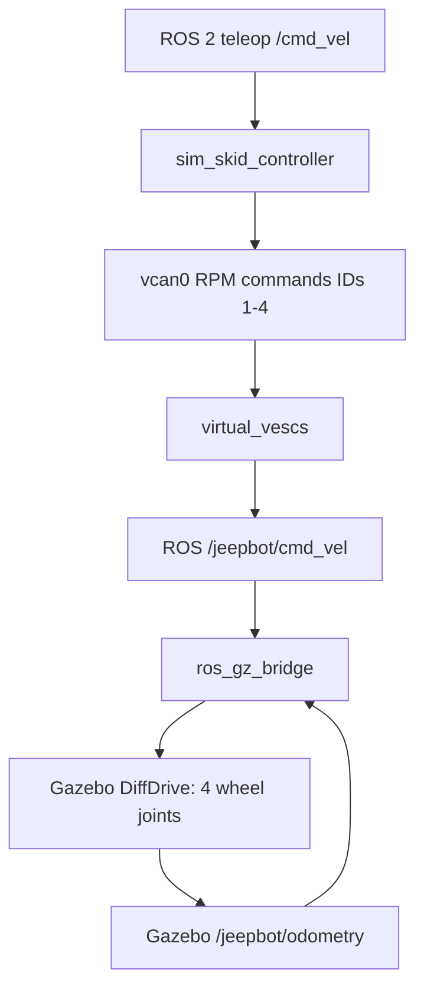

# JeepBot Four-Wheel Skid-Steer Simulation

**Runnable starter package**, with an illustrative JeepBot chassis, 4 independently rotating wheel joints, Gazebo skid-drive physics approximation, ROS 2 command bridge, and optional **four virtual VESC CAN command endpoints**. It is **not** a CAD-accurate reproduction of the real JeepBot, real VESC firmware emulation, or individually actuated four-wheel torque simulation.

## Architecture



In **direct mode**, publish `/jeepbot/cmd_vel` directly, bypassing the boxes between teleop and Gazebo. Do **not** publish to `/jeepbot/cmd_vel` directly while testing the virtual VESC chain, as that bypasses CAN.

## Required tools

- Ubuntu with compatible ROS 2 and Gazebo Sim. For ROS 2 **Lyrical**, Gazebo **Jetty** is the documented binary combination. For Jazzy, use Gazebo Harmonic.
- `ros_gz_sim`, `ros_gz_bridge`, `rclpy`, `geometry_msgs`, `nav_msgs`, `python-can`, `can-utils`, `colcon`.
- Gazebo GUI requires a working graphical display and GPU drivers. Headless `gz sim -s` can be used instead.

Check your distro:

```bash
echo "$ROS_DISTRO"
which gz
```

Install on Lyrical (adjust ROS_DISTRO / package names if needed):

```bash
sudo apt update
sudo apt install ros-${ROS_DISTRO}-ros-gz python3-can can-utils python3-colcon-common-extensions
```

## Install package

```bash
mkdir -p ~/ros2_ws/src
cp -r jeepbot_sim ~/ros2_ws/src/
cd ~/ros2_ws
source /opt/ros/$ROS_DISTRO/setup.bash
colcon build --packages-select jeepbot_sim --symlink-install
source install/setup.bash
```

## Mode A — Drive Gazebo directly (no CAN)

Terminal 1:

```bash
ros2 launch jeepbot_sim jeepbot_gazebo.launch.py
```

Terminal 2:

```bash
source ~/ros2_ws/install/setup.bash
ros2 topic pub -r 10 /jeepbot/cmd_vel geometry_msgs/msg/Twist \
  '{linear: {x: 0.25}, angular: {z: 0.0}}'
```

Stop command with Ctrl+C; then explicitly send a zero command, since the Gazebo DiffDrive plugin may retain the last commanded speed:

```bash
ros2 topic pub --once /jeepbot/cmd_vel geometry_msgs/msg/Twist \
  '{linear: {x: 0.0}, angular: {z: 0.0}}'
```

Turn left by publishing `linear.x: 0.15, angular.z: 0.5`. View ROS odometry using `ros2 topic echo /jeepbot/odometry`.

## Mode B — Route /cmd_vel through four virtual VESCs into Gazebo

Terminal 1 — create a Linux virtual CAN interface:

```bash
sudo modprobe vcan
sudo ip link add dev vcan0 type vcan  # ignore "File exists" if already present
sudo ip link set vcan0 up
```

Terminal 2 — launch the integrated simulation:

```bash
ros2 launch jeepbot_sim jeepbot_virtual_vesc.launch.py
```

Terminal 3 — monitor individual RPM commands:

```bash
candump vcan0
```

Terminal 4 — send vehicle velocity commands:

```bash
ros2 topic pub -r 10 /cmd_vel geometry_msgs/msg/Twist \
  '{linear: {x: 0.15}, angular: {z: 0.35}}'
```

Expected VESC command CAN IDs: `0x301` (FL), `0x302` (FR), `0x303` (RL), and `0x304` (RR). On left turns, FR/RR commands should exceed FL/RL. After Ctrl+C, the `/cmd_vel` command times out within about 0.25 s, and the bridge sends zero motion. You should see Gazebo motion via the entire command path.

**Scope limit:** the virtual VESC emulator reads four CAN RPM commands and converts them into an aggregate Twist for Gazebo's built-in DiffDrive plugin. It does **not** provide individual motor torque dynamics or real measured RPM CAN status packets. Odometry comes from Gazebo's plugin (simulated). Software CAN messages and the GUI may fail independently; test both.

## Geometry (all placeholders)

| Parameter | Starter | Replace with |
|---|---:|---|
| Wheel radius | 0.16 m | measured effective rolling radius |
| Track width | 0.68 m | center-to-center wheel spacing / calibrated effective track width |
| Front/rear wheel location | x = ±0.29 m | actual wheelbase |
| Body mass | 15 kg | measured mass and inertial properties |
| Motor gear ratio | 1.0 | motor turns per wheel turn |
| Motor pole pairs | 7 | actual motor pole pairs |

To change wheel geometry: edit `worlds/jeepbot_flat.sdf`, plus matching parameters in `jeepbot_sim/skid_controller.py` and `jeepbot_sim/virtual_vescs.py`, then rebuild. These files are deliberately separated from your actual `jeepbot_drive` hardware code.

## Test cases

1. Straight: `v=+0.15`, `w=0` → all four ERPM target magnitudes equal and positive.
2. Reverse: `v=-0.15`, `w=0` → all four negative.
3. Left arc: `v=+0.15`, `w=+0.35` → right-side ERPM greater.
4. Pivot left: `v=0`, `w=+0.35` → left negative, right positive.
5. Stop sending commands: the simulation controller sends zero after command timeout.
6. `candump vcan0`: all four addresses present.
7. Confirm ROS `/jeepbot/odometry` changes in response to movement.

## Known limitations / next improvements

- **No fifth steering motor**: modeled as fixed straight-front wheels. Verify the real JeepBot mechanism is mechanically safe to operate this way before applying power.
- Wheels are approximate cylinders, not JeepBot tire geometry.
- Four wheel joints are driven by **Gazebo's aggregate DiffDrive plugin**, not four independently modeled motor/ESC systems.
- No modeled battery voltage sag, current limits, regenerative braking, realistic motor heating, or VESC status/heartbeat emulation.
- For closer hardware-in-the-loop parity: replace the Gazebo DiffDrive plugin with `gz_ros2_control` and **four wheel velocity command interfaces**, and implement simulated VESC electrical/mechanical response, status packets and per-wheel faults.
- Never connect the simulation CAN node to real hardware; it rejects interfaces that do not begin with `vcan`.

## Source references

- [Gazebo official skid-drive example](https://github.com/gazebosim/gz-sim/blob/main/examples/worlds/diff_drive_skid.sdf)
- [Gazebo DiffDrive API](https://gazebosim.org/api/sim/10/classgz_1_1sim_1_1systems_1_1DiffDrive.html)
- [ROS–Gazebo bridge](https://gazebosim.org/docs/latest/ros2_integration/)
- [ROS/Gazebo compatibility](https://github.com/gazebosim/ros_gz)
- [VESC CAN protocol](https://github.com/vedderb/bldc/blob/master/documentation/comm_can.md)
